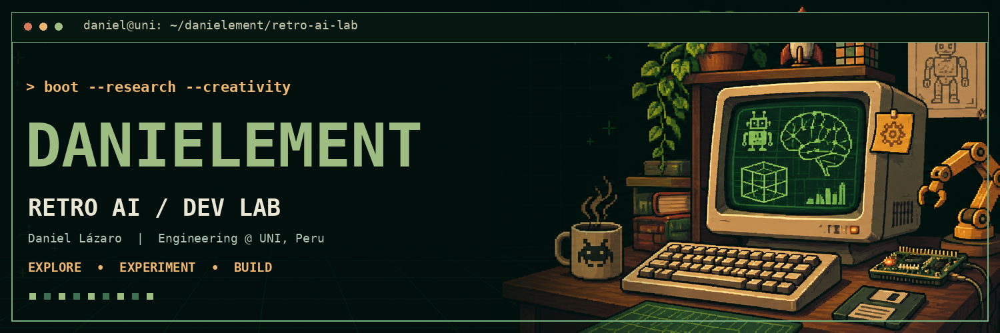
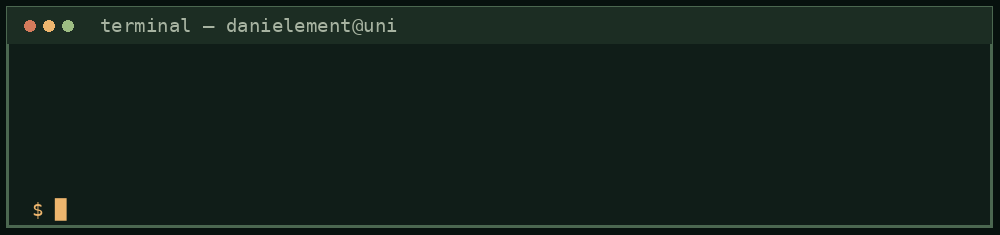
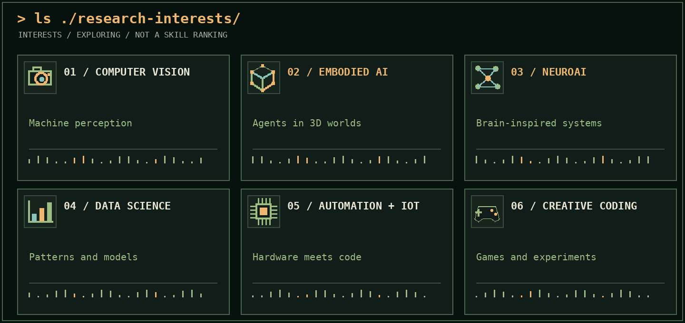
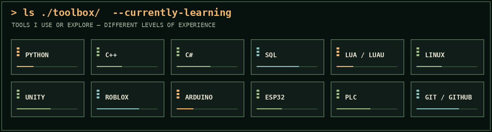

<div align="center">



### Daniel Lazaro / `Danielemento` · `@danielemento1byte`
**Industrial Engineering student · Universidad Nacional de Ingenieria (UNI), Peru 🇵🇪**

`aspiring AI researcher` · `creative coding` · `learning in public`

**Exploring Intelligence. Building Possibilities.**



</div>

### `$ whoami`

```console
╭─ daniel@1byte:~/about
│ NAME       Daniel Lazaro  //  Danielemento
│ BACKGROUND Industrial Engineering @ UNI, Peru
│ FOCUS      AI research · software + hardware · creative experiments
│ STATUS     curious / learning / building
│ EASTER_EGG 0x12 = 18 (decimal) · fits in 1 byte
╰─ $ ./stay-curious
```

Hi, I'm **Daniel**. I'm fascinated not only by what artificial intelligence can do, but by **how systems learn, perceive and interact with the world**. I enjoy exploring new ideas, training models, building software and hardware projects, and experimenting with whatever makes technology exciting — including things that don't work the first time.

I'm interested in **Computer Vision, Reinforcement Learning, Embodied AI, Brain-Inspired Intelligence and Data Science**, especially their potential in industry, robotics and aerospace. My long-term goal is to contribute to AI research; today, I'm focused on developing solid foundations and building projects that I can explain and improve.

### `$ cat ./research_interests.txt`

<div align="center">
  
</div>

**Curiosity queue:**
- **Computer Vision** — detection, tracking, perception and learning from visual data.
- **Machine Learning / Deep Learning** — training, evaluating and improving AI models.
- **Embodied AI / Reinforcement Learning** — training agents inside interactive 3D simulations.
- **NeuroAI** — what biological neural circuits and connectomes might teach us about intelligence.
- **Data Science** — statistics, analysis and data-driven research.
- **Intelligent Systems** — ideas for robotics, industrial automation and aerospace.

### `$ ls ~/toolbox --learning`

*These are technologies I use or explore at different stages of learning — **not** a claim of professional mastery.*

<div align="center">
  
</div>

```text
AI + DATA       Python · Machine Learning · Deep Learning · Computer Vision · Data Science
PROGRAMMING     C++ · C# · SQL · Lua / Luau
SIMULATIONS     Unity · Roblox Studio · 3D environments · Reinforcement Learning
HARDWARE        Arduino · ESP32 · Embedded Systems · IoT
INDUSTRY        PLCs · Industrial Automation
SYSTEMS         Linux · Git · GitHub
SECURITY        Cybersecurity fundamentals (exploring)
```

### `$ cat ~/hobbies.txt`

Outside my main research interests, I enjoy tinkering with **both software and hardware**. These are hobbies and learning interests, not claims of professional expertise.

- 🔌 **Arduino & ESP32** — microcontrollers, sensors, electronics, and DIY prototypes.
- 🐧 **Linux** — terminals, shell scripting, open-source tools, and understanding how systems work.
- 🔐 **Cybersecurity** — exploring computer security, networks, and ethical hacking in authorized environments.
- 💻 **Creative coding** — experimenting with languages, tools, and unexpected ideas.
- 🛠️ **Hardware builds** — combining circuits, sensors, programming, and intelligent systems.
- 🎮 **Game development** — Unity, Roblox Studio, and interactive experiences.

> Tiny geek detail: **0x12 = 18**, and `00010010` is the same number in 8-bit binary. That's my `1BYTE` easter egg. 🕹️

### `$ ls ~/lab_notes --ideas`

This is becoming my **engineering notebook and research-oriented portfolio**. I want each published project to have a clear question, a working demo where possible, instructions to reproduce it, results and lessons learned.

| Proposed experiment | Question I'd like to explore | Status |
|:--|:--|:--|
| **Vision Lab** | How robustly can a model detect and track objects under different conditions? | `IDEA` |
| **Agents in 3D** | How does reward design change an agent's learned behavior? | `IDEA` |
| **Physical AI Prototypes** | How can Arduino/ESP32, sensors, and models work together? | `IDEA` |
| **Linux & Security Lab** | What can I learn by building and testing secure systems in authorized environments? | `IDEA` |
| **Creative AI + Games** | What unusual experiences can be built with AI, Unity or Roblox? | `IDEA` |

> When a project is public, I'll replace the idea with a **real repository, demo, methodology and results**. No invented achievements or fake statistics here.

### `$ cat ~/beyond_code.txt`

I'm also planning to share **AI experiments, build logs, creative coding and occasional student-life videos** on YouTube. Some projects will be research-oriented; others might simply start with *“What if I try this?”* 🕹️

*Public channel and social links will go here once they are ready.*

### `$ ./next_level --research`

My long-term ambition is to pursue graduate research and contribute to **frontier AI**, particularly at the intersection of perception, learning and intelligent systems. Until then: ask questions, run experiments, learn from failures, repeat.

<details>
<summary><b>🇵🇪 Leer en español / About me in Spanish</b></summary>

¡Hola! Soy **Daniel Lázaro (Danielemento / @danielemento1byte)**, estudiante de **Ingeniería Industrial en la Universidad Nacional de Ingeniería (UNI), Perú**.

Me encanta investigar cómo los sistemas inteligentes aprenden, perciben e interactúan con su entorno. Mis intereses incluyen visión artificial, aprendizaje profundo, aprendizaje por refuerzo, simulación 3D, NeuroAI, ciencia de datos y automatización.

Como hobbies, también me gusta experimentar con **Arduino, ESP32, Linux, ciberseguridad**, electrónica, software y hardware; además exploro PLC, Unity, Roblox Studio y proyectos creativos. Estoy aprendiendo y construyendo poco a poco, con la meta de compartir experimentos reproducibles y, en el futuro, contribuir a la investigación en inteligencia artificial.

**Explorar la inteligencia. Construir posibilidades.**

</details>

---
<div align="center">

`[ SYSTEM: ONLINE ]` &nbsp; `> learn()` &nbsp; `> build()` &nbsp; `> repeat()`

<sub>🖥️ DaniElemento / 1BYTE Retro AI Lab · Made with curiosity, from Peru 🇵🇪</sub>

</div>

